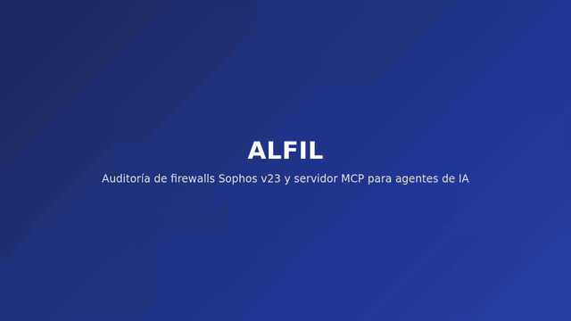

# ALFIL – Automated Layered Firewall Inspection & Logic

Auditoría de salud y diagnóstico para **Sophos Firewall**. ALFIL lee la configuración del equipo, detecta problemas de seguridad, calcula un puntaje de salud, genera reportes (PDF, Excel, ZIP), dibuja la topología de red y, con su **servidor MCP**, deja que un asistente de IA consulte el firewall, explique por qué pasa o no un tráfico y —solo si usted lo habilita— proponga cambios que una persona aprueba.

[](docs/demo/alfil-demo.mp4)

*Vista previa acelerada. [Video completo (~3 min, MP4)](docs/demo/alfil-demo.mp4) · cómo regrabarlo: [`docs/demo/README.md`](docs/demo/README.md).*

## Qué puede hacer

| Para… | ALFIL ofrece |
|---|---|
| **Auditar** | Hallazgos con severidad y **recomendación**: administradores sin MFA, administración expuesta a Internet, reglas Any→Any, duplicadas o sin registro, DNAT abierto, certificado por defecto, notificaciones, objetos sin uso… Puntaje 0–100. |
| **Saber qué no se evaluó** | Sección «Alcance»: las áreas que la API no ofrece o que fallaron, para no dar falsa cobertura. |
| **Comparar con el fabricante** | Verificación de políticas del propio Sophos (Health Check, CIS), aparte del puntaje (modo REST). |
| **Entregar** | Excel (hojas por tema), PDF y ZIP (con JSON). Revíselos siempre antes de enviarlos a un cliente. |
| **Ver la red** | Topología interactiva: zonas, interfaces/VLAN, rutas, VPN, avisos (salto inalcanzable, subredes solapadas…). |
| **Diagnosticar con IA** | Servidor MCP: `explain_path`, `explain_rule_match`, `trace_object_usage`, `find_unused_objects`, auditorías y más (21 herramientas, 2 prompts). |
| **Optimizar con control** | Cambios acotados propuestos por el agente, **con confirmación humana**, copia previa y registro de auditoría. Apagado por defecto. |

## Dos formas de conectar un firewall

| | **API REST v23** (recomendada) | **API XML** |
|---|---|---|
| Firmware | Sophos Firewall v23 o superior | Todas las versiones |
| Credencial | API key generada en Administración › Acceso API | Usuario con perfil *Auditor* (usuario y contraseña) |
| Requisito común | Autorizar la IP pública de ALFIL en Sistema › Administración › Acceso API (el formulario de conexión la muestra) | ídem |
| Velocidad | Segundos | Minutos en equipos lentos |
| Extras | MFA real de administradores, Health Check, MCP | — |

Las credenciales se guardan **cifradas** (Fernet + PBKDF2 con sal por instalación) y nunca se muestran de nuevo.

## Empezar en 5 minutos

```bash
cp .env.example .env
# Edite .env: ENCRYPTION_KEY (python -c "import secrets; print(secrets.token_hex(32))"), DOMAIN, CORS_ORIGINS
docker compose up --build
```

Abra la web (`http://localhost`), pulse **Nueva conexión**, elija *API REST v23*, escriba host, puerto (4444) y la API key, **Probar conexión** y **Crear conexión**. Luego **Auditar → Nueva auditoría**. La guía completa está en la sección **Documentación** de la propia web.

> **Seguridad:** ALFIL no trae autenticación de usuarios: despliéguelo detrás de VPN, proxy con autenticación o red restringida. Con `DEBUG=false` el backend no arranca si falta `ENCRYPTION_KEY` o es de ejemplo. Use un firewall de laboratorio para probar.

## Conectar un asistente de IA (MCP)

1. En la web, active **Disponible en MCP** en la conexión REST.
2. En el panel *Servidor MCP* pulse **Conectar un agente**, póngale nombre y caducidad: se crea **un token por agente**, revocable de forma individual.
3. Copie el fragmento para su agente (Claude Code, opencode, Codex, Cursor, VS Code…). Solo necesita la URL `https://SU-DOMINIO/mcp` y el token; ALFIL conserva la API key del firewall.

Ejemplos de uso: *«haz una revisión de salud del firewall»*, *«¿por qué no pasa TCP/22 desde 8.8.8.8 a 172.16.16.20?»*, *«¿dónde se usa el host X?»*. Detalle de herramientas y límites: [`alfil-mcp/README.md`](alfil-mcp/README.md).

### Cambios desde el MCP (opcional)

Un agente solo puede **proponer** y, con aprobación, aplicar cinco acciones no destructivas (crear regla, habilitar/deshabilitar, mover, crear host, crear servicio; **no hay borrados**). Requiere tres permisos a la vez: `MCP_ALLOW_WRITE=true` en el servidor, un token creado con permiso de escritura y el interruptor «Cambios desde el MCP» en la conexión. Cada cambio guarda una copia previa, verifica el resultado y queda en el registro de auditoría.

## Límites a tener en cuenta
- La revisión se basa en la **configuración**, no en el estado en vivo: no hay ruteo dinámico (OSPF/BGP/RIP), estado de enlaces ni logs.
- En modo REST no están disponibles NTP/zona horaria, estado del sistema, grupos de reglas ni SD-WAN (la API v1 no los expone o no están verificados); el reporte lo indica en «Alcance».
- `explain_rule_match` no evalúa NAT, inspección web/IPS, usuarios, horarios ni FQDN/país: esas reglas quedan como «posibles».
- Un asistente de IA recibe lo que devuelven las herramientas (reglas, objetos, direcciones). Úselo solo con datos que pueda compartir con su proveedor de modelo y con autorización del cliente.

## Documentación
- Guía de usuario: sección *Documentación* de la web (`alfil/frontend/src/content/guia.md`).
- Guía de desarrollo y arquitectura: [`docs/DESARROLLO.md`](docs/DESARROLLO.md) · Pruebas por módulo: [`docs/PRUEBAS_MODULOS.md`](docs/PRUEBAS_MODULOS.md).
- Fuentes oficiales y notas verificadas del firewall: [`docs/REFERENCES.md`](docs/REFERENCES.md).

## Stack

FastAPI + SQLAlchemy (SQLite) · React 18 + Vite + Tailwind · React Flow + ELK (topología) · MCP sobre HTTP (SDK `mcp`) · Docker Compose / Dokploy (Traefik).

## Variables de entorno

| Variable | Descripción |
|---|---|
| `ENCRYPTION_KEY` | Clave de cifrado (≥ 32 caracteres, obligatoria con `DEBUG=false`). Para rotarla ponga la anterior en `ENCRYPTION_KEY_OLD` durante un arranque. |
| `DOMAIN` | Hostname público para Traefik. |
| `CORS_ORIGINS` | Lista JSON de orígenes permitidos. |
| `DEBUG` | `false` en producción (por defecto). |
| `MCP_ALLOW_WRITE` | `false` por defecto; `true` habilita la fase de cambios con confirmación. |

Referencia completa en `.env.example`.

## Desarrollo

```bash
# Backend (usar la imagen Docker: Python 3.12)       # Frontend
cd alfil/backend && pip install -r requirements.txt   cd alfil/frontend && npm install && npm run dev
uvicorn app.main:app --reload
# MCP
cd alfil-mcp && python -m venv .venv && .venv/bin/pip install -e ".[dev]" && .venv/bin/python -m pytest
```

Tests: backend `pip install -r alfil/backend/requirements-dev.txt && pytest alfil/backend/tests`; más comandos en [`docs/DESARROLLO.md`](docs/DESARROLLO.md).
